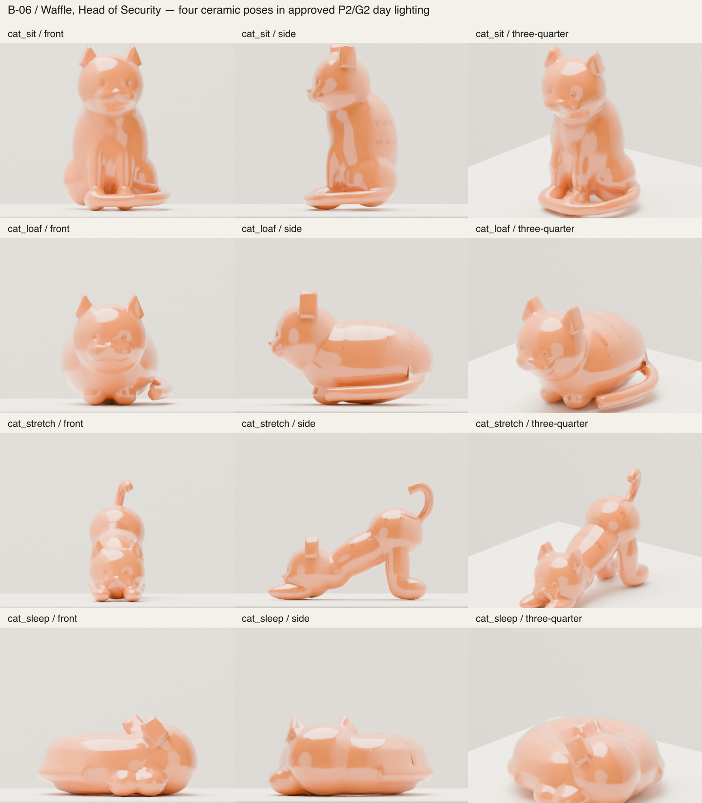
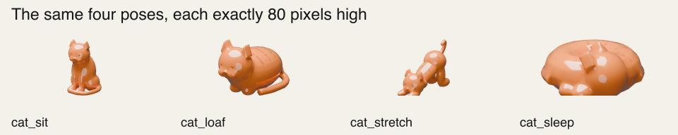
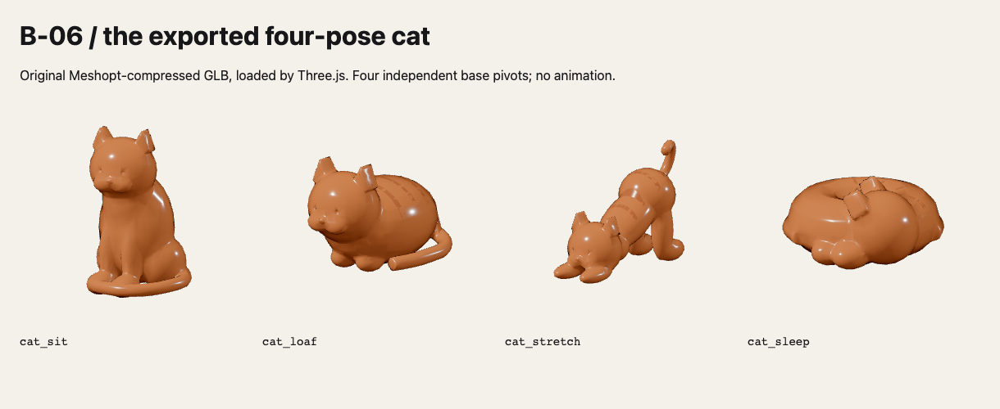

# Waffle, Head of Security

One original ceramic kitten in four static poses: `cat_sit`, `cat_loaf`,
`cat_stretch` and `cat_sleep`. The same rounded head, small triangular ears,
muzzle and pressed eyes identify every pose. The sleeping pose has closed
pressed curves, a tucked head and a curled body. There is no rig or animation.

Each named pose is a base-pivot node with its own mesh child. The pose pivots are
all at the origin, facing glTF +Z, with their base on Y=0. They intentionally
occupy the same space in the asset: the runtime chooses one pose, rather than
showing all four at once. The named parent keeps the base pivot stable when
meshopt quantises and recentres the geometry child.

The largest dimension is 0.22m. Rounded primitives are fused by voxel remeshing,
smoothed and decimated. Four narrow darker glaze ribbons are projected onto the
finished back surface. They share the second `glaze_dark` material slot and are
joined into the pose mesh; no image textures or third-party assets are used.

## Rebuild and inspect

```sh
pnpm assets -- --only cat
node blender/validate-cat.mjs
/Applications/Blender.app/Contents/MacOS/Blender --background --python-exit-code 1 --python blender/render-cat.py -- --samples 16
node blender/cat-contact-sheet.mjs
```

The renderer uses the approved B-02 P2/G2 palette and day-light values. Its camera
changes for front, side and three-quarter inspection. Raw renders stay under
ignored `blender/out/cat-views/`; only the contact sheets and render parameters
are committed. The small-pose proof trims transparent renders and resizes each
cat to exactly 80 pixels in height using Astro's existing sharp dependency.

Appearance is open to Matt's veto. These images show the exported design for
review; E-06 will decide where and when a pose appears.





The optimised GLB was loaded with Three.js GLTFLoader and Meshopt decoding. Each
pose was checked for triangle budget, metre scale and a world-space base pivot at
zero; no browser errors occurred.


