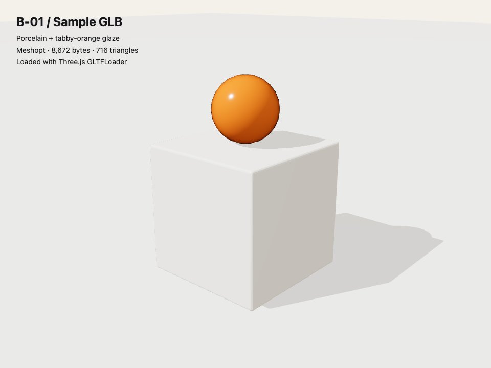

# Museum asset pipeline

Scene scripts are the source of truth. Generated `.blend` files and raw/intermediate
exports are not committed. Optimised `.glb` files in `public/models/` are committed.

Use Node 26, pnpm 10 and Blender 5.2 LTS. Install the repository's locked packages:

```sh
pnpm install --frozen-lockfile
pnpm assets -- --only _sample
pnpm assets
```

The default Blender executable is
`/Applications/Blender.app/Contents/MacOS/Blender`. Set `BLENDER_BIN` to another
executable path when needed. A missing executable or failed scene exits non-zero
with a diagnostic. Blender runs without opening its UI.

To inspect an unoptimised export directly:

```sh
"$BLENDER_BIN" --background --python-exit-code 1 --python blender/build.py -- --only _sample
```

For this command, set `BLENDER_BIN` first (the package script supplies the default).
Omit `--only` to run every Python scene file in `blender/scenes/`, in filename order.
Each module exposes `build(output_path)` and must export its scene to that path.
The shared reset helper uses Cycles CPU when available and reports an EEVEE
fallback if the Cycles add-on cannot be enabled. Model export does not render the
catalogue photographs; use `pnpm assets:stills` for those.

## Coordinate and naming contract

- Author in metres using Blender's Z-up coordinates. The GLB exporter converts to
  glTF +Y up. The centre of each exhibit's base becomes `(0, 0, 0)` in the GLB.
- Each exhibit has one root empty named `exhibit_<id>`. Parent every part to it.
  An exhibit fits inside a 0.5m cube.
- Touch parts are separate objects named `touch_<part>`, with their origin at the
  hinge or slide axis. Their custom properties `axis`, `kind` (`hinge` or `slide`)
  and `range` are exported as glTF extras. Axis names describe exported glTF axes.
- Camera stops, object anchors and other empties are retained by optimisation.
- Modifiers are applied on export; scene cameras and lights are excluded.
- Export wraps mesh touch parts in same-origin named pivot empties with geometry
  children. This preserves hinge/slide origins through position quantisation;
  raycast geometry can resolve its named touch ancestor.
- The `_sample` fixture has a bevelled porcelain cube and one glazed sphere. It
  demonstrates material reuse, hierarchy, extras, metre scale and a base at Y=0.

## Material rule

Use the shared factories in `lib/materials.py`:

- `porcelain`: sRGB `#F1EEE6`, roughness 0.85, metallic 0. Subsurface is disabled
  for GLBs and is only enabled by the explicit `still=True` option for later stills.
- `glaze`: sRGB `#E8741A`, roughness 0.15, clearcoat enabled.
- `room`: neutral wall/floor surface reserved for B-03's baked room.

Only the working part of an exhibit is glazed. Everything else is porcelain.
Additional materials require a comment on the Notion brief before introduction.

B-06's explicit cat-only exception makes Waffle entirely `glaze`, with four
slightly darker tabby stripes using `glaze_dark` (`#C95F12`, the same 0.15
roughness and clearcoat). The exception was recorded on the Notion brief before
implementation. No other exhibit uses this material. See [the cat source and
pose sheets](CAT.md) for the four-pose build and origin contract.

## Optimisation and budgets

`pnpm assets` runs Blender into ignored `blender/out/`, then runs glTF Transform:
`dedup`, `prune` (keeping empty leaves), `weld`, `resize` (maximum 1024×1024,
keeping aspect ratio), `webp`, and `meshopt`. No flattening or joining removes
named interaction parts. Draco is not used.

The script prints the final byte size and triangle count for every model,
including existing models outside a `--only` build. It rejects a proposed model
set of 1,500,000 bytes or more before replacing any committed output. Intermediate
files are cleaned up after success or failure. The budget is for the complete
`public/models/*.glb` set, not each individual file.

## Sample viewer

The screenshot below is the exported `_sample.glb` loaded by Three.js GLTFLoader
with Meshopt decoding, rather than a Blender still. Its contract and world-space
bounds were also checked in the viewer.



## B-02 look-development studies (P2/G2 approved)

The render-only `scenes/keyframe.py` builds a gallery corner, a 0.45m square × 1m
plinth with 3mm bevels, and an open cantilever toolbox with two swung-out trays.
Only the small drawer handle is glazed. It does not export a web model.

```sh
/Applications/Blender.app/Contents/MacOS/Blender --background --python-exit-code 1 --python blender/scenes/keyframe.py -- --only all
node blender/contact-sheet.mjs
```

Use `--only day`, `after-hours`, `close-up` or `variants` to rerender one part.
The three stills are 2400×1600, Cycles CPU, 32 samples with denoising, seed 7.
Variants are 800×480, 16 samples; the labelled contact sheet is 2400×1600.
Exact lighting and material parameters are recorded beside the stills in
`renders/keyframe/parameters.json`. Intermediate variant tiles go to ignored
`out/keyframe-variants/`.

Rows P1/P2/P3 compare porcelain roughness 0.75/0.85/0.95. Columns G1/G2/G3 compare
orange glaze sRGB #DF6D17/#E8741A/#EF7B20. The three main stills use the centre
P2/G2 baseline, approved by Matt in the Codex chat and recorded on the Notion
task. The shared factories use explicit approved constants: porcelain roughness
0.85 and glaze #E8741A. The remaining variants are retained for comparison.

Asset builds skip render-only modules and optimize only the asset names recorded
by Blender in the ignored build manifest. This keeps `pnpm assets` independent of
look-development render generation.

## Project exhibits (B-04)

`tools.py`, `flagz.py`, `waffle_agent.py`, `agent_skills.py` and `waystone.py`
author the five project exhibits. Each module exposes `create()` for review
renders and `build(output)` for shipping GLBs. Modules whose Python filename
uses underscores declare `MODEL_ID` so the output matches the runtime's hyphenated
ID (`waffle-agent`, `agent-skills`). The build manifest contains output IDs, never
assumed Python stems; invalid and duplicate IDs fail before export.

```sh
pnpm assets
pnpm assets -- --only agent_skills
/Applications/Blender.app/Contents/MacOS/Blender --background --python-exit-code 1 --python blender/review_models.py
node blender/model-contact-sheets.mjs
```

The canonical material reference is the **approved B-02 P2/G2 study** in
[`renders/keyframe/contact-sheet.png`](renders/keyframe/contact-sheet.png).
The five four-angle contact sheets and corresponding flat black silhouettes are
in `renders/project-models/`. `parameters.json` records their lighting, camera
and render settings. Silhouettes alter render state only, after GLB export; they
do not introduce another shipping material.

| Exhibit | Optimised bytes | Triangles | Touch pivots |
| --- | ---: | ---: | ---: |
| tools | 34,404 | 4,104 | 3 |
| flagz | 20,060 | 1,728 | 6 |
| waffle-agent | 40,676 | 4,648 | 1 |
| agent-skills | 40,064 | 4,824 | 9 |
| waystone | 15,604 | 1,222 | 1 |

All five are under the 120KB/15k-triangle per-model limit and fit inside a 0.5m
cube with the root at the centre of the base. No textures or modelled lettering
are used. The only glaze is the working part: one continuous handle, the repeated
flag idea, a connected syrup pool, the label-holder frame, or the inlaid waymark.
`tests/project-models.spec.ts` loads the actual compressed GLBs using Three.js
and Meshopt, checking dimensions, materials, budgets and every required pivot's
axis/kind/range metadata.

## B-03 gallery room

`scenes/room.py` authors a 30m × 6m × 4m straight gallery with nine bays. Its
single 2048px day atlas includes neutral skylight, bounce and local occlusion.
The raw PNG and intermediate GLB are generated under ignored `blender/out/`;
only the optimised `public/models/room.glb` is shipped. The room is the explicit
2048px exception to the object-texture 1024px cap. Both UV sets are retained; nearby porcelain faces receive four times the linear
UV density of the quiet room shell.

```sh
pnpm assets -- --only room
```

The map is baked with Cycles CPU, 32 samples, 4 AO subsamples, seed 11, a neutral 29m × 1.1m
2600W skylight and world strength 0.35. HDR bake values are tone-mapped through
AgX at exposure −1 before sRGB PNG/WebP conversion; this avoids clipping away
the shadows. The dynamic glazed rope is excluded from the neutral light bake. Shared approved porcelain/glaze values
are reused. Geometry includes a skirting shadow gap, continuous skylight slot,
eight full-size plinths, title wall, unhooked touch rope, board frame, portrait
frame/plane, gift-shop shelf and counter. Scene lights and cameras are not
exported. Named camera positions and targets are empty nodes instead.

### Lightmap transport to Three.js

The glTF standard has no dedicated Three.js `lightMap` slot. The baked combined
colour map is therefore carried by each baked material's **emissive texture on
UV1**, with extras `baked_lightmap: true`, `baked_uv: 1`,
`baked_transport: "emissive"`. This is a transport binding. The runtime maps the
same texture to an unlit `MeshBasicMaterial` with `channel = 1` and
`toneMapped = false`: the atlas already contains AgX/exposure−1 display colours,
surface colour and illumination. Applying another light or display transform
would distort the approved photograph match. After Hours lowers this material's
colour multiplier; the separate exhibit/glaze materials still use dynamic light.
UV0 remains available for the original portrait photograph. The rope's glaze is
not part of the static bake. See `src/gallery/README.md` for the measured runtime
colour calibration and source ownership.

### Placement contract

- `stop_0_cam` through `stop_8_cam` sit at exported eye height Y=1.5m. Targets
  have matching names. `placard_side` alternates left/right and `fov` is 35°.
- Object anchors: `anchor_tools`, `anchor_flagz`, `anchor_waffle-agent`,
  `anchor_agent-skills`, `anchor_waystone`, `anchor_open-mic`, `anchor_boom-bap`,
  `anchor_absent`, `anchor_gift-shop`.
- The room owns the full-size empty Absent Exhibit plinth, its dust and its
  shallow pressed pawprint. **`anchor_absent` is on the floor beside it**:
  B-05 supplies only the floor fragments, keeping that object within its 0.5m
  asset bounds. This follows the brief's pieces-on-the-floor visitor journey.
- At least ten `cat_<n>` nodes include a valid `pose` and `stop` extra. The
  runtime relocates its single figurine between these nodes only off-screen.
- `portrait_plane` is a named mesh with a normalised UV0 portrait surface.
- `touch_rope` has its pivot at the attached post and exports hinge metadata.
